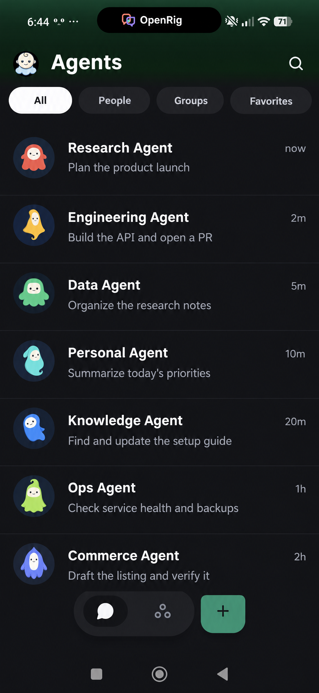

# OpenRig Matrix Bridge

[](https://github.com/ssalentin/openrig-matrix-bridge/actions/workflows/test.yml)
[](pyproject.toml)
[](LICENSE)

<!-- markdownlint-disable MD033 -->
<picture>
  <source media="(prefers-color-scheme: dark)" srcset="src/openrig_matrix_bridge/assets/branding/export/relay-secondary-dark-256.png">
  
</picture>
<!-- markdownlint-enable MD033 -->

OpenRig Matrix Bridge turns Matrix into a private interface to the Codex seats
already running in OpenRig. Use Element on desktop or mobile while the agent
keeps its existing terminal session, tools, and working context. There is no
second agent process.

Each configured seat gets one encrypted room for prompts, threaded progress,
final answers, encrypted attachments, and decisions. The bridge routes work
through the live OpenRig seat and records Matrix requests as durable OpenRig
queue items.



*Example view in the Element X Matrix client app on Android. This screenshot is
edited with generic sample content. See
[screenshot provenance](docs/screenshots/README.md).*

## What you get

- **One room per agent.** The bridge maps a Matrix room to an existing
  canonical Codex session; it never starts a second runtime.
- **State where the conversation lives.** The room topic and activity card show
  whether the seat is ready, working, or waiting for input.
- **Threaded results.** Prompts, activity, and final answers stay associated in
  Matrix threads.
- **Ordered follow-ups.** Additional requests queue FIFO, with one pinned card
  showing what is waiting.
- **Encrypted media.** Images, files, and voice notes travel inside Matrix
  E2EE. Local Parakeet transcription keeps audio on the bridge host.
- **Human decisions.** Queue-backed briefs and Element-compatible polls return
  the owner's choice to the responsible agent.
- **Restart-aware delivery.** Prompt, answer, attachment, and queue effects
  persist enough state to retry safely or fail closed.


## How it works

```text
Element Web or Element X
          |
          | private encrypted Matrix room
          v
OpenRig Matrix Bridge
          |
          | rig CLI + Codex transcript
          v
Existing OpenRig / Codex seat
```

The bridge resolves the seat's canonical session name, injects the prompt into
that terminal, and reads the seat's own Codex transcript for progress and the
final answer. Matrix prompts also create OpenRig queue items so work remains
visible and durable outside the chat client.

## Optional acceptance receipt

The bridge can add one 👍 to a human message once it has durably accepted it.
This is off by default; enable it with
`openrig.acceptance_reaction_enabled: true`. The 👍 means *accepted*, not
finished; the final answer is still the completion signal. When the
receipt is off, the status card and typing indicator are the live
acknowledgement for top-level and idle-thread messages. Steered or
late-admitted thread follow-ups, and any request in flight across a bridge
restart, are tracked in issue #47. See the
[user guide](docs/USER_GUIDE.md#optional-acceptance-receipt) for details.

## Follow-ups and steering

While a seat is working, `openrig.steering_mode` controls short follow-ups in
the same Matrix thread: `queue` keeps every request FIFO, `steer` attempts
best-effort delivery into the active seat, and the default `auto` steers only
eligible same-thread follow-ups. Top-level and other-thread prompts stay
separate and FIFO. A rapid same-thread batch keeps every source event ID and
qitem and gets one answer under the original thread root.

The bridge persists the transcript boundary and batch before pane input and
adopts the batch only on matching transcript evidence. While the seat is busy it
rescans rather than resends, so input that materializes as the next turn is
adopted once. If the seat is idle and admission is absent, the batch makes one
durable fallback attempt. A seat that stays busy without admission for
`openrig.response_timeout_minutes` ends in a visible terminal timeout recorded
in `steering_failures`.

Steering is best effort. OpenRig has no acknowledged safe model/tool boundary
or admission-turn response for pane input, so the bridge does not guarantee
mid-turn application or exactly-once delivery after a failed admission. Late
pane admission after the fallback deadline is a documented residual risk.

## Quick start

You need OpenRig with at least one running Codex seat, Python 3.11+, and a
dedicated Matrix bot account. A Matrix homeserver must be reachable over HTTPS.

1. Install the published 0.12.0 wheel, or install this checkout:

   ```bash
   python3 -m venv .venv
   . .venv/bin/activate
   python -m pip install -e '.[dev]'
   ```

2. Expose the bot token only through the environment:

   ```bash
   export MATRIX_ACCESS_TOKEN='...'
   ```

3. Discover the running seats and run setup:

   ```bash
   rig whoami --json
   rig ps --nodes -A --json

   openrig-matrix-bridge setup \
     --homeserver 'https://matrix.example.org' \
     --user-id '@openrig-bot:matrix.example.org' \
     --device-id 'OPENRIG_BRIDGE' \
     --allowed-user '@owner:matrix.example.org' \
     --config "$HOME/.config/openrig-matrix-bridge/config.yaml"
   ```

4. Check the configuration, then start the bridge:

   ```bash
   openrig-matrix-bridge doctor \
     --config "$HOME/.config/openrig-matrix-bridge/config.yaml"
   openrig-matrix-bridge run \
     --config "$HOME/.config/openrig-matrix-bridge/config.yaml"
   ```

5. Accept the invitation in Element and send a message to the new room.

The bridge creates one private encrypted room per discovered Codex seat. For
prerequisites, secret-safe setup, systemd, upgrades, and troubleshooting, use
the [installation guide](docs/INSTALLATION.md).

## Current boundaries

- Codex seats are supported; other OpenRig runtimes are not.
- Element device SAS and complete cross-signing remain unverified. See
  [Issue #1](https://github.com/ssalentin/openrig-matrix-bridge/issues/1).
- Voice model download is local, but recognition quality is not an automated
  product guarantee.
- Ordinary terminal chat is not mirrored into Matrix.
- A stopped seat remains configured but cannot receive prompts until its
  Codex session is running again.

The product is intentionally local-first and single-owner by default. It does
not claim homeserver metadata privacy, zero downtime, federation behavior, or
automatic trust on every Matrix device.

## Documentation

| Guide | What it covers |
|---|---|
| [User guide](docs/USER_GUIDE.md) | Statuses, threading, media, voice, decisions, queue behavior, and manual checks |
| [Installation](docs/INSTALLATION.md) | Prerequisites, Matrix credentials, setup, systemd, troubleshooting, and upgrades |
| [Security and trust](docs/SECURITY.md) | E2EE, secret handling, device verification, limits, and redaction |
| [Verification and evidence](docs/VERIFICATION.md) | Claim-by-claim automated, integration, and manual evidence |
| [Testing](docs/TESTING.md) | Local checks, integration harness, and artifact schema |
| [Screenshot provenance](docs/screenshots/README.md) | Capture environment, dimensions, crops, and redaction review |
| [Artifact manifest](docs/artifacts/README.md) | Redacted reports and release evidence |
| [Brand identity](docs/branding/README.md) | Relay assets, usage, previews, and licensing |

For release history and operations, see the
[0.12.0 release notes](docs/RELEASE_NOTES_0.12.0.md) and
[0.12.0 install and rollback runbook](docs/RUNBOOK_0.12.0.md).

## Security at a glance

- Rooms and supported media use Matrix end-to-end encryption.
- The bot access token is read from `MATRIX_ACCESS_TOKEN` and is not written to
  YAML.
- Only configured owner accounts can inject prompts.
- Matrix crypto state and downloaded media are sensitive local state; protect
  and back them up accordingly.
- Voice audio is processed locally after a checksum-verified model download.

Do not commit access tokens, private device keys, recovery material, raw
encryption state, private MXIDs, room IDs, homeserver credentials, or media.
Read the full [security model](docs/SECURITY.md) before exposing a bridge.

## Project status

The current package version is **0.12.0**. The committed integration harness
starts a disposable, digest-pinned Synapse and exercises real Matrix protocol
paths through a deterministic OpenRig transport. It does not prove a live Codex
model turn, real voice recognition quality, or human device verification.

The Element screenshots in this README are genuine client captures over the
disposable harness; their synthetic transport boundary is recorded alongside
the images.

For development checks:

```bash
python -m pytest -q
ruff check .
python tools/check_markdown_links.py
npx --no-install markdownlint-cli2
python -m build
python tools/verify_release.py
```

## License

MIT. See [LICENSE](LICENSE).
