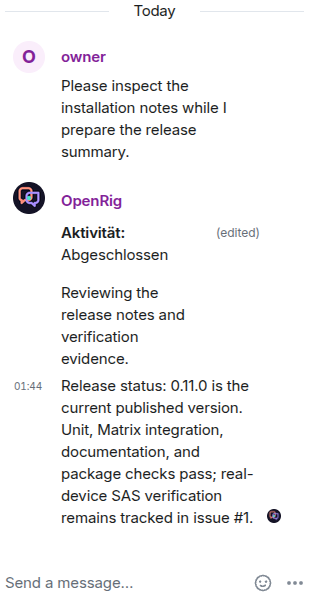
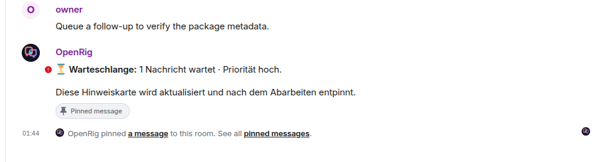

# Documentation screenshots

These are genuine Element Web renders captured against disposable Synapse with
synthetic accounts and a deterministic OpenRig transport. They are product
illustrations, not live-Codex proof and not device-verification evidence.

## `element-web-thread.png`



This 316 x 610 crop isolates the right-hand thread from a 1440 x 1000 Element
Web capture. It shows the owner prompt, the `Aktivität: Abgeschlossen` card with
natural commentary, and the final answer. It demonstrates thread composition
and the activity-to-answer flow.

## `element-web-queue.png`



This 1010 x 270 crop isolates the queued follow-up and pinned queue card from a
1440 x 1000 capture. It shows one waiting Matrix request at high priority and
the message that explains when the card will be updated or unpinned.

## Provenance

| Field | Value |
|---|---|
| Capture date | 2026-10-24 |
| Element Web | 1.12.32 |
| Element image | `vectorim/element-web@sha256:f8700633d4336258af7a05b53865a4f479e0d628cf2d9ca83d28b5939314d4ce` |
| Homeserver | Disposable Synapse on loopback |
| Synapse image | `matrixdotorg/synapse@sha256:390f5e67227378eb87c84627b57f0582cdb235fcc8159d89f371f37bf7cccfd7` |
| Accounts | Synthetic `owner` and `integration-agent@local` fixtures |
| Browser | Chrome through `agent-browser` 0.39.2 |
| Raw viewport | 1440 x 1000 |
| OpenRig boundary | Deterministic `tools/fake_openrig.py` transport; not a live Codex model turn |

The raw captures remain outside the repository. The committed files were
created with these exact crop operations:

```bash
convert raw-thread.png -crop 316x610+1124+390 +repage element-web-thread.png
convert raw-queue.png -crop 1010x270+430+630 +repage element-web-queue.png
```

The queue crop removes room setup history and status lines that contained the
synthetic local fixture MXID. No MXID is visible in either committed image. The
thread crop removes the room and navigation chrome, including the same fixture
identifier. No pixels were generated or reconstructed, and no text was added.

## Redaction review

- Both images were inspected at original resolution after cropping.
- Neither image contains an access token, password, recovery key, device key,
  room ID, homeserver address, private MXID, or private infrastructure name.
- Visible fixture names are limited to `owner`, `OpenRig`, `Integration Agent`,
  and generic synthetic release-status copy.
- The images do not show hover tooltips, decryption failures, device warnings,
  or integration-log wording.
- The Element account remained unverified during capture, so these images make
  no SAS or cross-signing claim.
